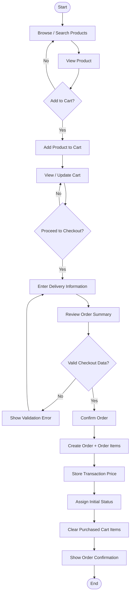
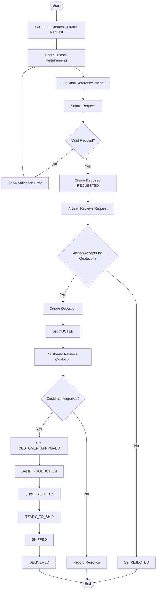
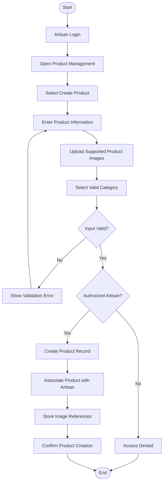

# Craft BD — Activity Diagrams

**Phase:** 07 — UML & System Analysis  
**Version:** 0.1

This document contains activity models for the three main Craft BD workflows.

---

# 1. Standard Order Activity Diagram



## Main Rules

- Empty cart cannot proceed to valid order creation.
- Transaction-time price shall be preserved.
- Order belongs to authenticated Customer.
- Invalid checkout data prevents confirmation.

---

# 2. Structured Custom Order Activity Diagram

**Status:** PROVISIONAL



## Critical Business Rule

```text
Quotation Approved
        ↓
Required Before
        ↓
Production
```

Invalid example:

```text
QUOTED → IN_PRODUCTION
```

without Customer approval.

---

# 3. Artisan Product Creation Activity Diagram



## Important Rules

- Product must belong to the authenticated Artisan.
- Product price and stock must be valid.
- Category must be valid.
- Unsupported files must be rejected.
- Another Artisan cannot manage the Product.

---

# 4. Workflow Comparison

| Workflow | Main Actor | Main Decision |
|---|---|---|
| Standard Order | Customer | Checkout valid? |
| Custom Order | Customer + Artisan | Quotation approved? |
| Product Creation | Artisan | Product data valid and authorized? |

---

# 5. System Analysis Observation

The activity models show three different workflow styles:

### Transaction Workflow

```text
Product → Cart → Checkout → Order
```

### Negotiation Workflow

```text
Request → Quote → Approval → Production
```

### Resource Management Workflow

```text
Artisan → Product Data → Validation → Product Record
```

This distinction will guide later Sequence, Class, API, and testing design.

---

## Status

**Activity Diagrams:** Complete v0.1  
**Standard Order:** Included  
**Structured Custom Order:** Included  
**Product Creation:** Included  
**Research Boundary:** Preserved
