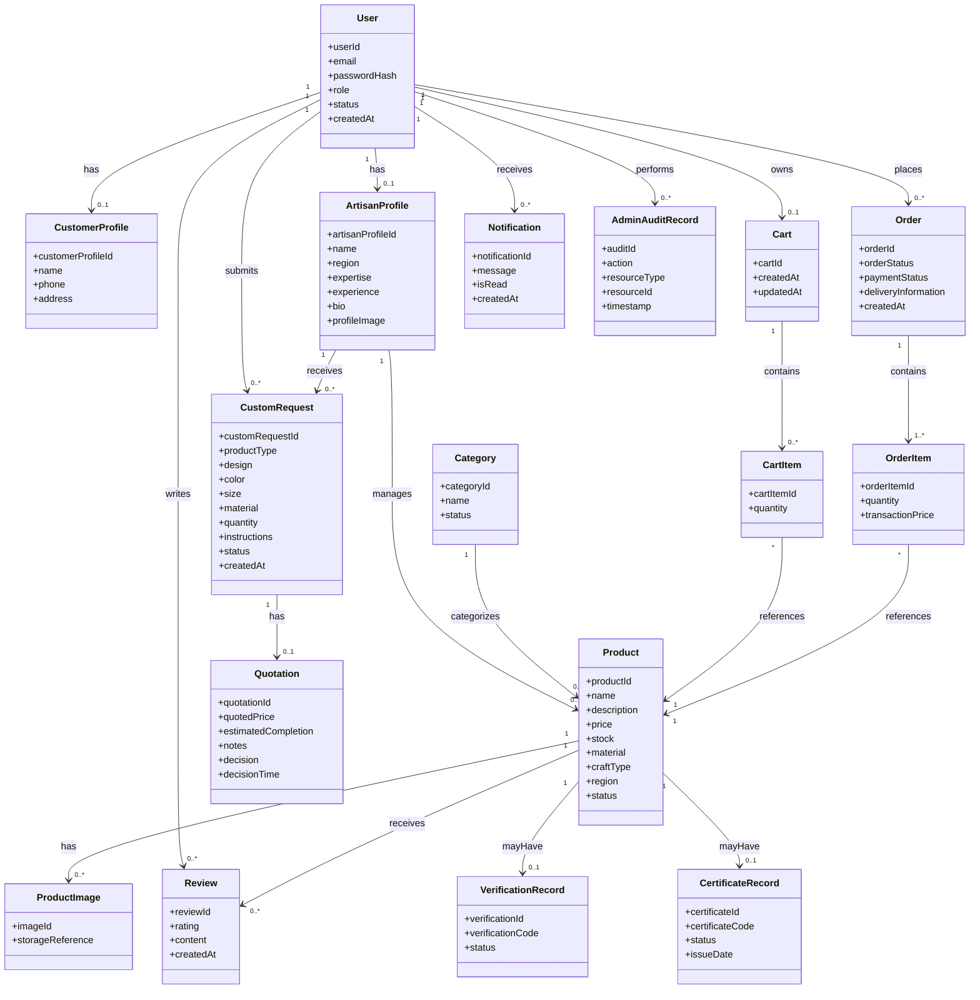

# Craft BD — Class Diagram

**Phase:** 07 — UML & System Analysis  
**Version:** 0.1  
**Source:** SRS v0.1 + Phase 06 Use Cases  
**Status:** Draft Baseline

---

# 1. Purpose

This document defines the main domain classes and relationships required to support Craft BD.

The class model represents system-analysis concepts.

It does not yet define the final database schema or implementation framework.

---

# 2. Core Class Diagram



---

# 3. Class Responsibilities

## User

Represents an authenticated Craft BD account.

Main responsibilities:

- Authentication identity
- Role assignment
- Account status

Supported roles:

```text
CUSTOMER
ARTISAN
ADMIN
```

---

## CustomerProfile

Stores Customer-specific profile information.

Related to:

- Orders
- Cart
- Custom Requests
- Reviews

Private customer information shall remain protected.

---

## ArtisanProfile

Represents public and operational Artisan information.

Main responsibilities:

- Artisan identity
- Expertise
- Region
- Public biography
- Product ownership

---

## Product

Represents a handicraft product.

Main responsibilities:

- Product information
- Price
- Stock
- Category
- Artisan relationship
- Discovery data

Product ownership is controlled through the Artisan relationship.

---

## Category

Provides structured Product classification.

Categories are managed by an authorized Administrator.

Historical Product relationships shall remain preserved when a Category is deactivated.

---

## Cart and CartItem

Represent temporary Customer purchase preparation.

```text
Customer
→ Cart
→ CartItem
→ Product
```

Cart values do not replace confirmed Order history.

---

## Order and OrderItem

Represent confirmed standard commerce transactions.

```text
Customer
→ Order
→ OrderItem
→ Product
```

`OrderItem.transactionPrice` preserves transaction-time price.

This protects historical order integrity when Product prices later change.

---

# 4. Custom Order Classes

## CustomRequest

**Status:** PROVISIONAL DOMAIN CLASS

Represents Customer customization requirements.

May contain:

- Product type
- Design
- Color
- Size
- Material
- Quantity
- Instructions
- Reference image association
- Workflow status

Relationships:

```text
Customer
   ↓
CustomRequest
   ↑
Artisan
```

---

## Quotation

**Status:** PROVISIONAL DOMAIN CLASS

Represents the Artisan's commercial proposal for a Custom Request.

Contains:

- Quoted price
- Completion estimate
- Notes
- Customer decision
- Decision timestamp

Relationship:

```text
CustomRequest
     ↓
Quotation
```

Production eligibility depends on approved quotation state.

---

# 5. Supporting Classes

## Review

Connects:

```text
Customer
→ Review
→ Product
```

Review creation depends on approved eligibility rules.

---

## Notification

Represents a user-facing notification generated from meaningful workflow events.

Notification data is not the authoritative source of workflow state.

---

## VerificationRecord

**Conditional Class**

Represents a Craft BD platform verification record associated with a Product.

It does not independently prove physical-product authenticity.

---

## CertificateRecord

**Optional Class**

Represents an optional Craft BD platform certificate record.

It shall not automatically be treated as government or third-party certification.

---

## AdminAuditRecord

Represents selected high-impact administrative actions where auditability is required.

Examples:

- User deactivation
- Content moderation
- Verification deactivation
- Certificate revocation

---

# 6. Important Relationships

## Artisan → Product

```text
ArtisanProfile 1
      ↓
   0..* Product
```

One Artisan may manage multiple Products.

Each Artisan-managed Product belongs to one Artisan.

---

## Product → Category

```text
Category 1
   ↓
0..* Products
```

Each categorized Product references a valid Category.

---

## Order Composition

```text
Order
 ◆── OrderItem
```

OrderItem depends on the Order transaction.

The final database design may implement this using foreign keys and cascading rules appropriate to historical preservation.

---

## Cart Composition

```text
Cart
 ◆── CartItem
```

CartItem belongs to the active Cart.

---

# 7. Standard Commerce Domain Model

```text
Customer
   ↓
Cart
   ↓
CartItem
   ↓
Product
```

then:

```text
Customer
   ↓
Order
   ↓
OrderItem
   ↓
Product
```

This separation prevents active Cart data from becoming historical Order data.

---

# 8. Custom Commerce Domain Model

```text
Customer
      ↓
CustomRequest
      ↓
Quotation
      ↓
Customer Decision
      ↓
Production Status
```

Artisan relationship:

```text
ArtisanProfile
      ↓
CustomRequest
      ↓
Quotation
```

---

# 9. Ownership Model

Important ownership direction:

```text
User
├── CustomerProfile
└── ArtisanProfile
```

```text
ArtisanProfile
→ Product
```

```text
Customer
→ Cart
→ Order
→ CustomRequest
→ Review
```

Protected actions shall validate these relationships.

---

# 10. Class Diagram vs Database Schema

This UML Class Diagram answers:

```text
What important objects exist?
How are they related?
What information do they conceptually contain?
```

It does **not** yet answer:

```text
Exact SQL table names
Exact data types
Indexes
Foreign-key actions
Normalization decisions
Database vendor
```

Those will be finalized in Phase 10 — Database Design.

---

# 11. Traceability Examples

| Class | Main Requirement Area |
|---|---|
| User | FR-AUTH-* |
| ArtisanProfile | FR-ART-* |
| Product | FR-PROD-* |
| Category | FR-ADMIN-003–005 |
| Cart / CartItem | FR-CART-* |
| Order / OrderItem | FR-ORDER-* |
| CustomRequest | FR-CUSTOM-001–017 |
| Quotation | FR-CUSTOM-018–028 |
| Review | FR-REV-* |
| Notification | FR-NOTIF-* |
| VerificationRecord | FR-VERIFY-* |
| CertificateRecord | FR-CERT-* |

---

# 12. Research Boundary

The following classes remain dependent on provisional or optional scope:

### Provisional

- CustomRequest
- Quotation

### Conditional

- VerificationRecord

### Optional

- CertificateRecord

Their presence in the UML model does not mean their product value has been fully validated.

---

## Document Status

**Class Diagram:** Complete v0.1  
**Core Domain Classes:** Included  
**Relationships:** Included  
**Standard Commerce Model:** Included  
**Custom Workflow Model:** Included  
**Optional Modules Marked:** Yes  
**Final Database Schema:** Not defined in this phase
