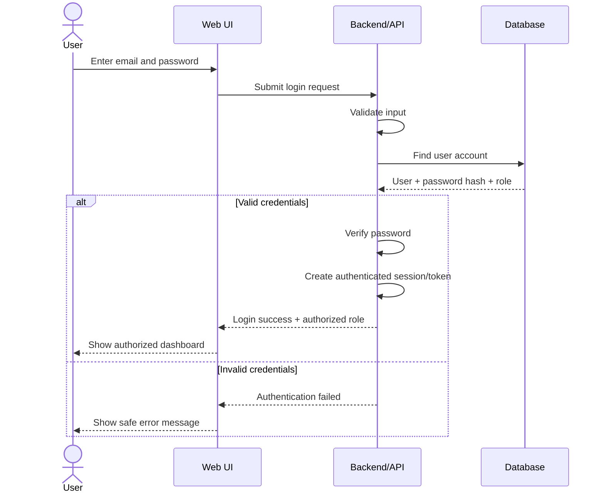
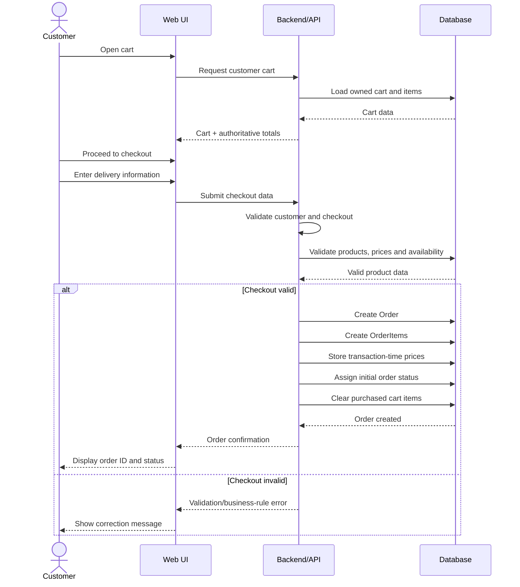
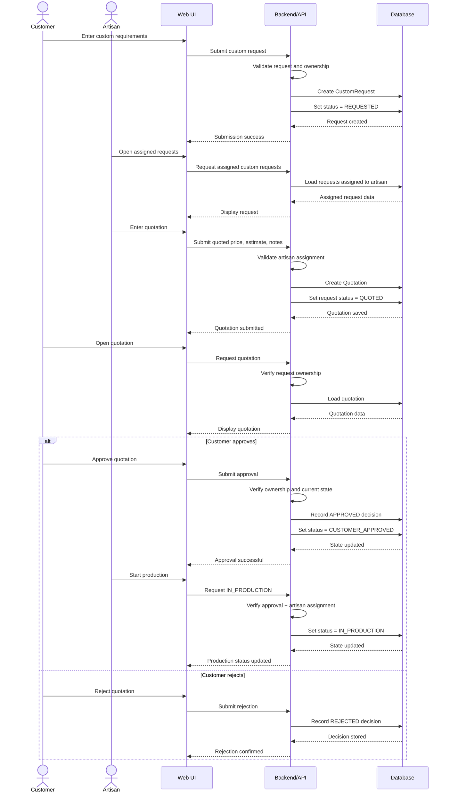

# Craft BD — Sequence Diagrams

**Phase:** 07 — UML & System Analysis  
**Version:** 0.1  
**Source:** SRS v0.1 + Phase 06 Use Cases

---

# 1. Login Sequence Diagram



## Main Rules

- Password shall not be stored as readable plain text.
- Invalid credentials shall not create a session.
- Role controls protected functionality.
- Login errors shall not expose sensitive internal information.

**Traceability:**  
`FR-AUTH-003–005 → UC-AUTH-003 → US-001`

---

# 2. Standard Order Sequence Diagram



## Important Rules

```text
Browser-submitted total
≠
Authoritative order total
```

Backend shall verify:

- Product availability
- Quantity
- Current authoritative price
- Customer ownership
- Required delivery information

Historical order prices shall remain unchanged if the current Product price changes later.

**Traceability:**  
`FR-CART-* + FR-ORDER-001–010 → UC-ORDER-001 → US-004/005`

---

# 3. Custom Request → Quotation → Approval Sequence Diagram

**Status:** PROVISIONAL



## Critical Rule

Production requires:

```text
Valid Quotation
      +
Customer Approval
      +
Assigned Artisan
```

Therefore this must be rejected:

```text
QUOTED
→ IN_PRODUCTION
```

without approval.

## Security Checks

Before protected actions:

```text
Authentication
→ Role
→ Ownership / Assignment
→ Current State
→ Business Rule
→ Action
```

**Traceability:**  
`FR-CUSTOM-001–033 → UC-CUSTOM-001/003/004/005 → US-007–010`

---

# 4. Sequence Diagram Summary

| Diagram | Primary Actors | Main Purpose |
|---|---|---|
| Login | User | Authentication and role recognition |
| Standard Order | Customer | Cart-to-order transaction |
| Custom Workflow | Customer + Artisan | Request, quotation, approval, production guard |

---

# 5. System Analysis Observation

The three diagrams expose three important backend responsibilities:

```text
Authentication Flow
→ Identity + Authorization
```

```text
Commerce Flow
→ Data + Transaction Integrity
```

```text
Custom Flow
→ Ownership + State-Machine Integrity
```

These responsibilities will later influence:

- Architecture
- API design
- Database design
- Security
- Integration testing

---

# Research Boundary

The Custom Order sequence remains **PROVISIONAL** until primary Customer and Artisan validation is completed.

The diagram represents current intended system behavior only.

---

## Document Status

**Sequence Diagrams:** Complete v0.1  
**Login:** Included  
**Standard Order:** Included  
**Custom Workflow:** Included  
**Security/Business Rules:** Represented  
**Research Boundary:** Preserved
