# Craft BD — Use Case Diagram

**Phase:** 07 — UML & System Analysis  
**Version:** 0.1  
**Source:** Phase 06 Use Case Model

## 1. Actors

- Visitor
- Customer
- Artisan / Seller
- Administrator

## 2. System Use Case Diagram

```mermaid
flowchart LR

    V[👤 Visitor]
    C[👤 Customer]
    A[👤 Artisan / Seller]
    AD[👤 Administrator]

    subgraph CBD["Craft BD System"]
        AUTH1((Register))
        AUTH2((Login))
        DISC1((Browse / Search Products))
        DISC2((View Product Details))
        ART1((View Artisan Profile))

        PROF1((Manage Customer Profile))
        CART1((Manage Cart))
        ORD1((Place Standard Order))
        ORD2((Track Order))
        REV1((Submit Review))

        APROF((Manage Artisan Profile))
        PROD1((Create / Manage Products))
        OSTAT((Update Order Status))

        CUS1((Submit Custom Request))
        CUS2((Review Custom Request))
        CUS3((Create Quotation))
        CUS4((Approve / Reject Quotation))
        CUS5((Update Custom Order Status))
        CUS6((Track Custom Order))

        ADMIN1((Manage Users))
        ADMIN2((Manage Categories))
        ADMIN3((Moderate Content))
        ADMIN4((Handle Exceptional Cases))

        VERIFY((View Verification Record))
    end

    V --> AUTH1
    V --> AUTH2
    V --> DISC1
    V --> DISC2
    V --> ART1
    V --> VERIFY

    C --> DISC1
    C --> DISC2
    C --> ART1
    C --> PROF1
    C --> CART1
    C --> ORD1
    C --> ORD2
    C --> REV1
    C --> CUS1
    C --> CUS4
    C --> CUS6
    C --> VERIFY

    A --> AUTH2
    A --> APROF
    A --> PROD1
    A --> OSTAT
    A --> CUS2
    A --> CUS3
    A --> CUS5

    AD --> AUTH2
    AD --> ADMIN1
    AD --> ADMIN2
    AD --> ADMIN3
    AD --> ADMIN4
```



## 3. Important Relationships

### Standard Commerce

```text
Browse Product
→ View Product
→ Manage Cart
→ Place Order
→ Track Order
→ Submit Eligible Review
```

### Custom Order

```text
Submit Custom Request
→ Artisan Review
→ Create Quotation
→ Customer Approve / Reject
→ Update Custom Order Status
→ Track Custom Order
```

### Administration

```text
Administrator
→ Manage Users
→ Manage Categories
→ Moderate Content
→ Handle Exceptional Cases
```

## 4. Security Boundary

Protected use cases require:

```text
Authentication
→ Authorization
→ Ownership / Assignment
→ Business Rule Validation
```

## 5. Research Boundary

Custom-order use cases remain **PROVISIONAL** until primary Customer and Artisan validation is completed.

## Status

**Use Case Diagram:** Complete v0.1  
**Actors:** 4  
**Core Workflows Represented:** Yes  
**Custom Workflow Boundary:** Preserved
